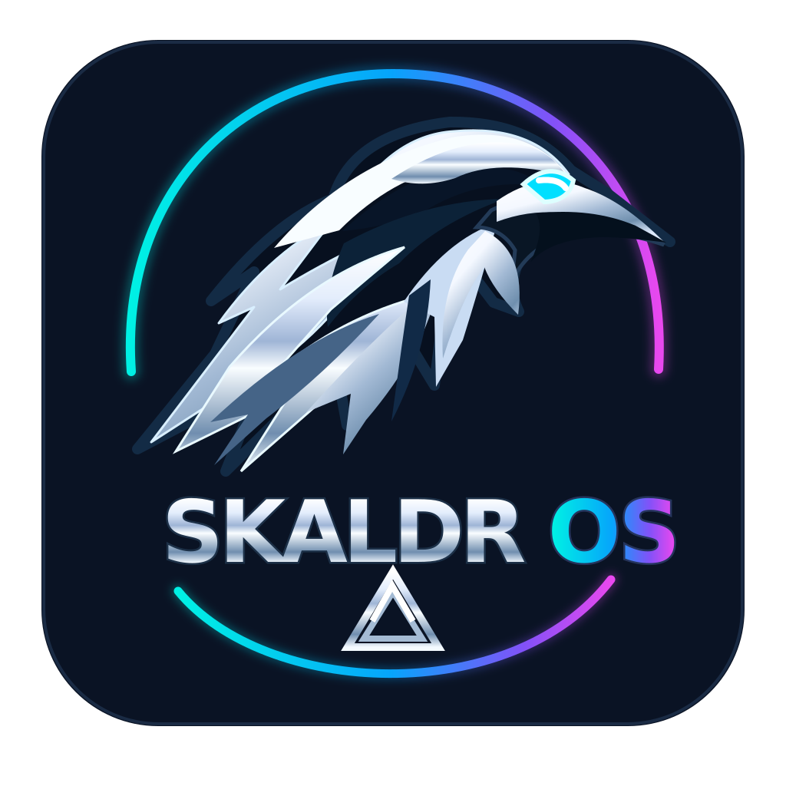

<p align="center">
  
</p>

<h1 align="center">Skaldr OS</h1>

<p align="center"><strong>Performance by intention. Freedom by design.</strong></p>

<p align="center">
  An independent, CachyOS-based Linux desktop — created as a personal project and shared openly in case it helps someone else.
</p>

<p align="center">
  <a href="https://github.com/pomercier/Skaldr-OS/actions/workflows/skaldr-checks.yml"></a>
  <a href="https://github.com/pomercier/Skaldr-OS/actions/workflows/build.yml"></a>
  <a href="https://github.com/pomercier/Skaldr-OS/releases/tag/v0.1.0-preview.3"></a>
  
</p>

<p align="center">
  <a href="#public-download--skaldr-os-v010-preview3">Download preview.3</a> ·
  <a href="#latest-vm-validated-development-iso--dev149">Exact ISO dev.149</a> ·
  <a href="#download-skaldr-os-v010-preview2">Public preview.2</a> ·
  <a href="#download-and-verify-the-public-preview">Public preview</a> ·
  <a href="#why-skaldr">Why Skaldr?</a> ·
  <a href="#the-desktop">The desktop</a> ·
  <a href="#versions-you-can-trace">Versioning</a> ·
  <a href="#build-it-yourself">Build</a> ·
  <a href="#project-status">Project status</a>
</p>

---

## A desktop built around the things that matter

Skaldr OS grew from a simple idea: **build the Linux system I actually want to use every day** — fast, flexible, comfortable for gaming and development, and maintainable without rebuilding everything from scratch.

It is built on the work of **[CachyOS](https://cachyos.org/)** and **[Arch Linux](https://archlinux.org/)**. The goal isn't to pretend to replace these projects. It is to add an opinionated, cohesive desktop experience while preserving broad hardware compatibility and upstream improvements.

> **[Skaldr OS v0.1.0-preview.3](https://github.com/pomercier/Skaldr-OS/releases/tag/v0.1.0-preview.3) is now publicly available.** Its embedded `dev.149` ISO passed **154 source tests and 5/5 VM jobs**, including real KDE installation, native ArtCraft GUI and offline Btrfs rollback. The seven public files were published on November 18, 2026 from the exact tested [`1b4c3d0` source](https://github.com/pomercier/Skaldr-OS/commit/1b4c3d0c4be1b828edbfd3e202e97a13f0ddb89f). Download and verify the parts using [these instructions](#public-download--skaldr-os-v010-preview3). This is a development preview, **not a hardware-certified stable release**.

## Why Skaldr?

| Built to feel fast | Ready to do more | Hardware-aware |
| :--- | :--- | :--- |
| CachyOS foundations, a preferred `scx_lavd` Gaming profile, performance mode, and ZRAM support. | KDE Plasma, gaming tools, media applications, creative tools, native development and QEMU/KVM. | Detect NVIDIA, AMD, Intel and hybrid graphics; ask before making driver changes. |

| Your everyday workspace | Recover when necessary | No mystery builds |
| :--- | :--- | :--- |
| Brave, LibreOffice Fresh, `yay`, `kcalc`, CMake, Make, fakeroot and other practical utilities. | Btrfs snapshots when applicable, recovery boot options and diagnostic tools. | Each developer ISO records its Skaldr change count, Git revision and UTC build date. |

### What Skaldr deliberately avoids

No mandatory NVIDIA, AMD or Intel driver. No automatic GPU overclock. No Flatpak, Snap or Docker in the default distribution. No forced passwordless `sudo` or insecure installed-system login. No rebranding that hides the upstream work.

The preference for permanent performance settings is intentional, but compatibility checks and recovery paths must take precedence over a system that fails to boot.

## The desktop

**KDE Plasma is the only desktop environment offered by Skaldr OS.** Other environments can be installed manually later using the Arch package manager. Skaldr favors a clean desktop with NumLock enabled, normal authentication preserved, and a native toolbox for checking system health, GPU drivers and performance settings.

- **Gaming:** Steam, GameMode, MangoHud, Gamescope and compatibility tools are part of the current package selection.
- **Multimedia and work:** VLC, FFmpeg, LibreOffice Fresh, Brave and other native utilities.
- **Development:** Git, Python, Rust, CMake, Make, Ninja, fakeroot, yay and related tools.
- **Virtualization:** QEMU/KVM and Virt-Manager, when the hardware supports them.
- **Graphics:** CachyOS `chwd` discovers applicable drivers; a first-boot assistant asks before installing them. LACT is available only where supported.
- **Recovery and diagnostics:** Snapper integration on Btrfs, `skaldr-doctor` and the new native Qt6 Control Center with a KDE fallback. The interface keeps privileged changes behind confirmation and polkit.

**Performance/security choice:** the requested `mitigations=off` kernel option is currently used for normal boot entries. It disables some CPU security mitigations and is not appropriate for every threat model. A fallback boot entry without this setting is retained.

## Versions you can trace

A rolling-release base can change every day, but **Skaldr's own release number should still mean something**.

Development builds use:

```text
Skaldr OS 0.1.0-dev.N+gSHA
```

Here `N` counts first-parent commits since the original CachyOS fork point; `SHA` identifies the exact source revision. The UTC build date and full 40-character SHA are recorded in the installed build metadata. Upstream CachyOS history is not incorrectly counted as Skaldr development.

On first login, a welcome screen shows this version and build provenance. Later, the same facts are available from:

```bash
skaldr-version
skaldr-version --json
skaldr-doctor --json
```

The public [`v0.1.0-preview.2` tag](https://github.com/pomercier/Skaldr-OS/releases/tag/v0.1.0-preview.2) points to validated source `e37fdd25`, and its ISO retains embedded build version `0.1.0-dev.129`. The previous preview.1 embeds `dev.62`. A stable `v0.1.0` still requires physical-hardware and recovery validation. See [the versioning policy](docs/VERSIONING.md).

## Build it yourself

Skaldr is currently a source-first project. Building its ISO requires a supported Arch/CachyOS environment, sufficient disk space, and access to the package mirrors.

```bash
sudo pacman -Syu --needed archiso mkinitcpio-archiso git squashfs-tools grub
git clone https://github.com/pomercier/Skaldr-OS.git
cd Skaldr-OS
./buildiso.sh -h
sudo ./buildiso.sh -p desktop -v -w
```

The expected output is in `out/desktop/`. The build includes a version manifest and generates SHA-256 checksums. **Do not assume the generated image is installable until its build and VM tests pass.** You can follow the [ISO build workflow](https://github.com/pomercier/Skaldr-OS/actions/workflows/build.yml).

## Public download — Skaldr OS v0.1.0-preview.3

**[Download all seven permanent GitHub Release assets](https://github.com/pomercier/Skaldr-OS/releases/tag/v0.1.0-preview.3)**.
This is the exact **VM-validated `dev.149` ISO**, not a new or untested compilation.

Download all three `skaldr-0.1.0-dev.149-x86_64.iso.partNNN` pieces
and the four supporting files (`SHA256SUMS`, `SHA256SUMS.parts`,
`ASSEMBLE.txt`, `reassemble-skaldr-iso.py`) into the same folder.

```sh
python3 reassemble-skaldr-iso.py reassemble --directory .
sha256sum -c SHA256SUMS
```

The expected complete ISO SHA-256 is `e29503551ba643d93e5d0137c06ba0ea22dbeb55c6fde335537bebc7f92cd4f9`; size
is **4,194,566,144 bytes**. **Only flash the verified, reassembled
`.iso` file**, never a `.partNNN` file. The release tag points to
exact source `1b4c3d0c4be1b828edbfd3e202e97a13f0ddb89f`, matching
[154 successful source tests](https://github.com/pomercier/Skaldr-OS/actions/runs/44164284682)
and [five successful ISO jobs](https://github.com/pomercier/Skaldr-OS/actions/runs/44164284698).
Public download reconstruction on an additional independent GitHub runner:
[verification workflow](https://github.com/pomercier/Skaldr-OS/actions/workflows/skaldr-preview3-public-integrity.yml).

**Preview, not stable:** real NVIDIA/AMD/Intel hardware, Secure Boot and
encrypted installation still require separate tests.

## Latest VM-validated development ISO — dev.149

**[Download the complete `dev.149` ISO artifact](https://github.com/pomercier/Skaldr-OS/actions/runs/44164284698/artifacts/14364619884)** from the fully successful
[November 17, 2026 CI run](https://github.com/pomercier/Skaldr-OS/actions/runs/44164284698).
The ZIP contains the complete `skaldr-0.1.0-dev.149-x86_64.iso`,
`SHA256SUMS`, `calamares-source.sha`, and its package audit.
This download is **not** a permanent GitHub Release, and you may need to log in.

On CachyOS or Arch Linux, GitHub CLI offers reproducible direct retrieval:

```sh
sudo pacman -S --needed github-cli
gh auth login
mkdir -p "$HOME/Downloads/Skaldr-OS"
gh run download 44164284698 --repo pomercier/Skaldr-OS --name skaldr-os-x86_64-261117 --dir "$HOME/Downloads/Skaldr-OS"
cd "$HOME/Downloads/Skaldr-OS"
sha256sum -c SHA256SUMS
```

The expected complete `dev.149` ISO SHA-256 is:

```text
e29503551ba643d93e5d0137c06ba0ea22dbeb55c6fde335537bebc7f92cd4f9
```

The source is [`1b4c3d0c`](https://github.com/pomercier/Skaldr-OS/commit/1b4c3d0c4be1b828edbfd3e202e97a13f0ddb89f);
the actual upstream Calamares installer revision, verified after makepkg and
recorded alongside the ISO, is `255a96ed16dbb73ceb535ddf2e18b5f07f0b2cc7`.
**154/154 source tests and all five ISO jobs passed**: BIOS live desktop,
GRUB/ext4 KDE installation and native ArtCraft GUI, Limine/Btrfs KDE
installation and offline rollback, and complete independent SHA-256
reassembly. [Full evidence and known limits](docs/CI-VALIDATED-DEV149.md).

For now, use a disposable VM or spare drive. **Do not overwrite your current
CachyOS installation or imply physical RTX 3080 compatibility was tested.**

## Download Skaldr OS v0.1.0-preview.2

**[Official public development-preview downloads](https://github.com/pomercier/Skaldr-OS/releases/tag/v0.1.0-preview.2)**

Download **all seven release assets** to the same directory: three files named
`skaldr-0.1.0-dev.129-x86_64.iso.part001`, `.part002`, and `.part003`;
plus `SHA256SUMS`, `SHA256SUMS.parts`, `ASSEMBLE.txt`, and
`reassemble-skaldr-iso.py`. The image is split because each public GitHub
Release asset must fit below 2 GiB. **Do not write a `.part` file to USB.**

Use Python 3 to verify the parts and reconstruct the original ISO:

```sh
python3 reassemble-skaldr-iso.py reassemble --directory .
sha256sum -c SHA256SUMS
```

On Windows, `py` can replace `python3`; the included script independently
verifies the downloaded files and full assembled image. The expected SHA-256 of
`skaldr-0.1.0-dev.129-x86_64.iso` is:

```text
177b5667b29338db66473ebefb739551ee35edb116cd6b650e2ec6d9f4517b2e
```

The source revision is
[`e37fdd25`](https://github.com/pomercier/Skaldr-OS/commit/e37fdd25e01e9564223f426c3ff4000dbdd5ef5b):
[148 passing source tests](https://github.com/pomercier/Skaldr-OS/actions/runs/43924758916)
and [five passing ISO jobs](https://github.com/pomercier/Skaldr-OS/actions/runs/43924758899).
The [release publication and independent reconstruction](https://github.com/pomercier/Skaldr-OS/actions/runs/43996058008)
also passed **both jobs**. The public files' individual SHA-256 values matched
the pinned original CI evidence and reproduced the same full-size ISO.

Use a spare SSD or a non-production test machine and consult the
[physical-hardware checklist](docs/HARDWARE-TESTING.md). Installed KDE Plasma
Login branding, GRUB/ext4 and Limine/Btrfs installs, BIOS live boot and
offline Btrfs rollback were validated in QEMU; physical graphics, Secure
Boot, encryption and legacy BIOS **installation** are not certified.

## Archive: previous public preview.1

**[Skaldr OS v0.1.0-preview.1 — seven release files](https://github.com/pomercier/Skaldr-OS/releases/tag/v0.1.0-preview.1)**

This November 13, 2026 preview contains a validated 4.14 GB ISO, based on
[commit b391fc35](https://github.com/pomercier/Skaldr-OS/commit/b391fc35f4eaade3c1ff5231c33c10f63770bda6).
It passed [source checks](https://github.com/pomercier/Skaldr-OS/actions/runs/43507232909)
and [five ISO validation jobs](https://github.com/pomercier/Skaldr-OS/actions/runs/43507233020).

Download every asset into the **same folder**: three pieces named
`skaldr-0.1.0-dev.62-x86_64.iso.part001`, `.part002`, `.part003`;
`SHA256SUMS`, `SHA256SUMS.parts`, `reassemble-skaldr-iso.py`, and `ASSEMBLE.txt`.
The ISO is split to respect GitHub Releases' per-file size limit.

Run from that folder with Python 3 installed:

```sh
python3 reassemble-skaldr-iso.py reassemble --directory .
```

Use `py` instead of `python3` on Windows if appropriate. The utility verifies
each part and the original complete ISO **before** making it available.
Expected final ISO SHA-256:

```text
b553c0e4cfe01e1de0c857f1dc4c70ac89d41a762bdb01750c770bb77069ec49
```

**Flash only the verified `.iso`, never an individual part.** Use a spare drive
or non-production test machine and read the
[physical-hardware test checklist](docs/HARDWARE-TESTING.md).
All seven release assets were uploaded. Independent download, checksum checks
and full ISO reconstruction of the publicly released preview.1 also passed on
[a separate Ubuntu runner](https://github.com/pomercier/Skaldr-OS/actions/runs/43780766882).

## Project status

**The newest public development preview is [`v0.1.0-preview.3`](https://github.com/pomercier/Skaldr-OS/releases/tag/v0.1.0-preview.3) (embedded `dev.149`)**: [154/154 source checks](https://github.com/pomercier/Skaldr-OS/actions/runs/44164284682),
[5/5 ISO jobs](https://github.com/pomercier/Skaldr-OS/actions/runs/44164284698),
installed KDE with a genuine ArtCraft UI check, GRUB/ext4, Limine/Btrfs
rollback, BIOS live boot and independent image SHA-256 reconstruction.
The older [`v0.1.0-preview.2`](https://github.com/pomercier/Skaldr-OS/releases/tag/v0.1.0-preview.2)
(`dev.129`) remains archived. Physical hardware, Secure Boot and untested
storage layouts remain uncertified.

| Area | Current state |
| --- | --- |
| Base | Public CachyOS Live ISO fork, upstream-compatible |
| KDE and software profile | Defined in the Live and target manifests |
| Driver selection | Hardware-aware assistant implemented; real-device matrix still required |
| Performance and Btrfs policies | Initial implementation; platform testing ongoing |
| Version provenance | Implemented in build tooling and first-login welcome |
| CI source validation | Automated on `master` |
| Public preview | **Published** [v0.1.0-preview.3](https://github.com/pomercier/Skaldr-OS/releases/tag/v0.1.0-preview.3), seven assets from the exact VM-tested `1b4c3d0`; earlier [preview.2](https://github.com/pomercier/Skaldr-OS/releases/tag/v0.1.0-preview.2) remains archived |
| Independent public download and reassembly | **Passed** for all seven preview.2 GitHub Release assets; reproduced exact `dev.129` ISO SHA-256 on a separate Ubuntu runner ([2026-11-16, run 43996058008](https://github.com/pomercier/Skaldr-OS/actions/runs/43996058008)). The earlier preview.1 passed its own [independent check](https://github.com/pomercier/Skaldr-OS/actions/runs/43780766882) |
| Full ISO build, installation and rollback | **Passed 5/5** on `1b4c3d0` (2026-11-17), including GRUB/ext4 installed KDE with real ArtCraft GUI, Limine/Btrfs rollback and cold boot, legacy BIOS live boot and full `dev.149` ISO SHA-256 reconstruction ([run 44164284698](https://github.com/pomercier/Skaldr-OS/actions/runs/44164284698)). Physical hardware, encrypted storage and legacy BIOS **installation** remain untested |
| Installed Plasma Login and ArtCraft | **Passed** on `dev.149`: KDE first login, branding, ArtCraft AppImage checksum and real GUI catalog in GRUB/ext4 QEMU; independent ArtCraft recheck also [passed](https://github.com/pomercier/Skaldr-OS/actions/runs/44163757616) |
| Physical hardware and final appearance approval | Not yet certified; testing checklist available |

The project's priorities and gaps are tracked in [the development roadmap](docs/ROADMAP.md). Use [safe update, power and diagnostic controls](docs/SAFE-CONTROLS.md), the [hardware test checklist](docs/HARDWARE-TESTING.md) and the [community compatibility report template](docs/HARDWARE-COMPATIBILITY.md).

## Built personally. Shared publicly.

Skaldr OS is **a personal passion project**, not a business, not a paid product, and not a promise to support every possible device forever.

If the configuration helps another Linux user, that is already a good reason to keep the source public. Contributions and thoughtful bug reports may help improve it over time. Reproducible reports should include the version from `skaldr-version`, hardware details and relevant logs — not passwords or private files.

A future mention on [DistroWatch](https://distrowatch.com/) would be a pleasant milestone, **not a requirement or a measure of success**. The software should earn that attention by being useful, honest and consistently maintained.

## Credits

This project stands on the work of **CachyOS**, **Arch Linux**, the **KDE** community, **Calamares** and the many developers behind the included free and open-source packages. Skaldr OS is **not an official CachyOS project or endorsed edition**.

The original authorship, licenses and credits of upstream files are retained. See [LICENSE](LICENSE).

<p align="center"><em>Make it fast. Keep it usable. Share what works.</em></p>
